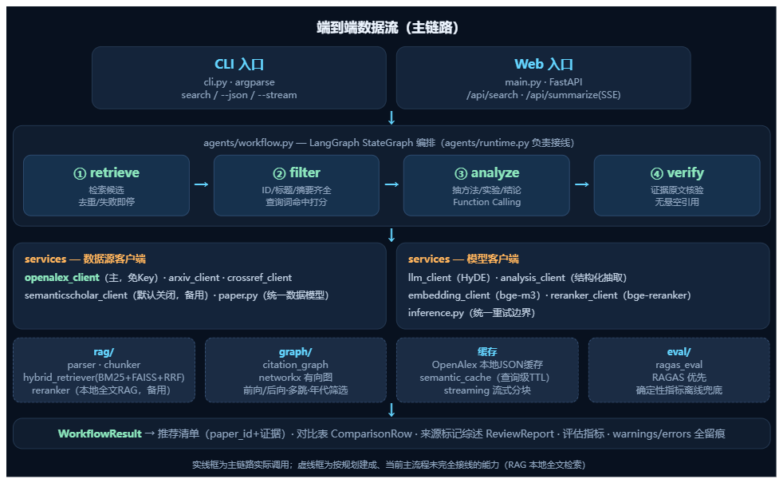

# 自动化论文检索与分析 Agent

一个用于研究论文发现、分析和引用追踪的 Python 3.11 应用程序。

# 整体架构与数据流

目录结构:
```text
自动化论文检索与分析 Agent/
├── cli.py                                           # CLI 入口：argparse + 缓存 + 工作流 + 综述 + 评估
├── main.py                                          # FastAPI 入口：搜索/论文详情/SSE 流式综述/评估 API
├── demo.ps1                                         # 一条端到端演示命令
├── pyproject.toml                                   # 构建/依赖/pytest 配置
├── .env.example                                     # 环境变量模板（注意：内含一个真实样式 Key，见第六节）
├── README.md / PROJECT_BRIEF.md / PROJECT_GUIDE.md  # 说明 / 章程 / 实施指南
├── config/
│   ├── settings.py                                  # Pydantic Settings：全部配置项与默认值
│   └── __init__.py                                  # 导出 Settings / get_settings
├── services/                                        # 服务层：所有外部 API/模型调用（可 mock、可降级）
│   ├── paper.py                                     # 跨数据源统一模型 Paper / RelatedPaper
│   ├── openalex_client.py                           # 主数据源：检索/详情/前向后向引用 + JSON缓存 + 限流
│   ├── arxiv_client.py                              # arXiv Atom API 适配器（自带一套 Paper dataclass）
│   ├── crossref_client.py                           # CrossRef DOI 元数据（可选，按 DOI 补全）
│   ├── semanticscholar_client.py                    # Semantic Scholar（默认关闭的备用源）
│   ├── llm_client.py                                # LLM：HyDE 假设性摘要生成
│   ├── analysis_client.py                           # LLM：Function Calling 结构化抽取 + 宿主校验 + 兜底
│   ├── embedding_client.py                          # bge-m3 稠密向量（懒加载）
│   ├── reranker_client.py                           # bge-reranker 交叉编码器打分（懒加载）
│   ├── inference.py                                 # 可选模型推理的统一重试/降级边界
│   ├── review_service.py                            # 由已验证证据确定性生成综述与对比表
│   ├── streaming.py                                 # 综述文本按块切分（伪流式）
│   └── semantic_cache.py                            # 查询级持久化缓存（规范化 query+limit，带 TTL）
├── rag/                                             # 本地全文 RAG 能力（M1/M2）
│   ├── parser.py                                    # PyMuPDF 解析 PDF 逐页文本
│   ├── chunker.py                                   # 标题感知的段落切片（限长 + overlap）
│   ├── hybrid_retriever.py                          # BM25 + FAISS 稠密双路召回，RRF 融合，HyDE
│   └── reranker.py                                  # 用交叉编码器对候选重排并截断 Top-k
├── graph/
│   └── citation_graph.py                            # networkx 有向引用图：多跳 BFS、年代/经典最新筛选
├── agents/                                          # Agent 编排层（M4）
│   ├── schemas.py                                   # 全流程 Pydantic 契约（严格模式 extra=forbid）
│   ├── prompts.py                                   # 分析/推荐理由的 Prompt 片段
│   ├── workflow.py                                  # LangGraph 四节点工作流（核心）
│   └── runtime.py                                   # 生产环境接线：OpenAlex + 可选 S2 备用
├── eval/
│   └── ragas_eval.py                                # RAGAS 评估 + 确定性离线指标兜底
├── frontend/
│   └── index.html                                   # 单页前端（ECharts 力导向引用图 + SSE 综述）
└── tests/                                           # 28 个测试文件，与各模块一一对应
```

## 架构

创建并激活一个虚拟环境，安装项目及其开发依赖项，然后运行：

```powershell
python -m pip install -e ".[dev]"
python -m pytest
python cli.py --help
```

将 `.env.example` 复制为 `.env`，仅在使用需要凭证的服务时提供凭证。配置是通过 Pydantic Settings 读取的。

# 工作流

现在，CLI 运行一个可追溯的工作流：

```powershell
python cli.py search "retrieval augmented generation" --limit 5
python cli.py search "citation graph provenance" --limit 5 --json
```

该工作流程使用 OpenAlex 作为主要的学术来源，并辅以 Semantic
Scholar默认情况下被禁用。它执行检索、轻量级相关性
筛选、结构化论文分析和引用验证。每一条被接受的推荐
包含一个 `paper_id`、一个证据引用和一个明确的分析模式。
标准搜索命令还会生成一个比较表，带有来源标签
审查，以及数值 `faithfulness` / `context_recall` 指标；`--review` 和
`--eval` 仍被接受为显式开关。
重复的归一化查询使用本地语义查询缓存，以及 `--stream`
逐步打印评论：

```powershell
python cli.py search "retrieval augmented generation" --limit 5 --stream
python cli.py search "  Retrieval   Augmented Generation " --limit 5 --json
```

当缓存 TTL 尚未过期时，第二个命令会重用第一个查询的缓存工作流结果。JSON 输出包括 `cache_hit`。
当 LLM 不可用时，工作流会使用明显标记的提取型回退，而不是虚构结果。
网络和模型故障会降级为结构化的空结果或部分结果。

OpenAlex 配置可在 `.env` 中找到：

```text
LITSEARCH_SCHOLAR_PROVIDER=openalex
LITSEARCH_OPENALEX_MAILTO=your@email.com
LITSEARCH_OPENALEX_RPS=8
LITSEARCH_SEMANTIC_SCHOLAR_ENABLED=false
```

## 端到端演示

从项目根目录开始：

```powershell
python cli.py search "citation graph provenance" --limit 5 --stream
```

这运行 OpenAlex 检索、过滤、论文分析、引用验证、带来源标签的审查生成，以及两个评估指标。
如果未配置任何 LLM 凭据，输出会明确使用提取式回退；不会添加不支持的结论。
## 回归问题集

该项目包括 120 个中文研究问题，分为 12 类：`data/test_questions.jsonl`。
使用以下方式验证其大小、唯一性和类别覆盖情况：

```powershell
python scripts/validate_question_set.py
```

该问题集基准将真实的 RAGAS 结果与确定性的来源代理区分开。
当没有模型生成的基准输出可用时，它不会报告虚构的 RAGAS 改进。

## Web 前端

轻量级的 FastAPI 前端仅使用 `frontend/index.html` 和浏览器 JavaScript；
没有 npm 或 React 构建步骤：

```powershell
uvicorn main:app --reload
```

打开 `http://127.0.0.1:8000`。
该页面提供论文搜索、SSE 评审流、可点击的来源标记、OpenAlex 引文图加载以及评估指标栏。
